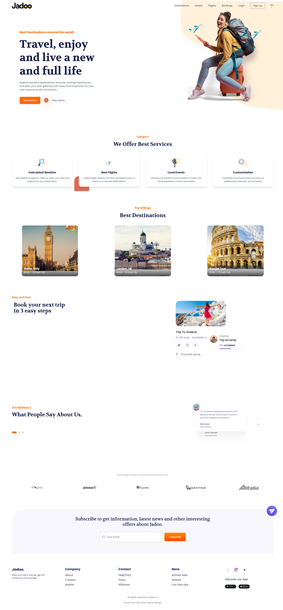

# Travel-Agency-Landing-Page

A fully responsive travel agency landing page, built from the **Jadoo** Figma Community design using HTML, Tailwind CSS v4 and vanilla JavaScript.

🔗 **Live demo:** [awesomised.github.io/travel-landing-page](https://awesomised.github.io/travel-landing-page/)



<p>
  
</p>

## Features

- **Sticky navbar:** transparent at the top of the page, turns into a blurred white bar on scroll
- **Mobile menu:** hamburger icon that animates into an X, with a full-width dropdown and an overlay
- **Closes easily:** the menu closes via the overlay, a link click, the Escape key, or resizing to desktop
- **Scroll reveal animations** built with `IntersectionObserver`
- **Newsletter form** with email validation and inline feedback
- **Responsive layout** from small phones up to large desktops
- **Accessibility:** ARIA labels, `aria-expanded` on the menu button, and support for `prefers-reduced-motion`

## Tech Stack

- HTML5
- [Tailwind CSS v4](https://tailwindcss.com/) (CLI build)
- Vanilla JavaScript (no frameworks)
- Google Fonts: Poppins, Volkhov

## Getting Started

```bash
# 1. Clone the repository
git clone https://github.com/awesomised/travel-landing-page.git
cd travel-landing-page

# 2. Install dependencies
npm install

# 3. Build the CSS (watch mode)
npx @tailwindcss/cli -i ./style.css -o ./output.css --watch
```

Then open `index.html` in your browser (or use the VS Code **Live Server** extension).

To create a minified production build:

```bash
npx @tailwindcss/cli -i ./style.css -o ./output.css --minify
```

## Project Structure

```
travel-landing-page/
├── Assets/          # Images, icons and logos
├── screenshots/     # README previews
├── index.html       # Page markup and JavaScript
├── style.css        # Tailwind input + custom CSS
├── output.css       # Compiled CSS (generated)
└── README.md
```

## Credits

- **Design:** [Jadoo](https://www.figma.com/community) travel landing page, Figma Community
- **Code and implementation:** Kashif Altaf
- Brand logos in the "partners" strip are used only as visual placeholders from the design and do not represent real clients.

## Author

**Kashif Altaf**
GitHub: [@awesomised](https://github.com/awesomised)
